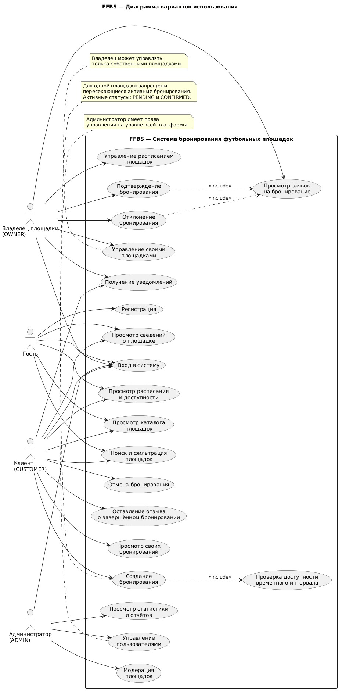
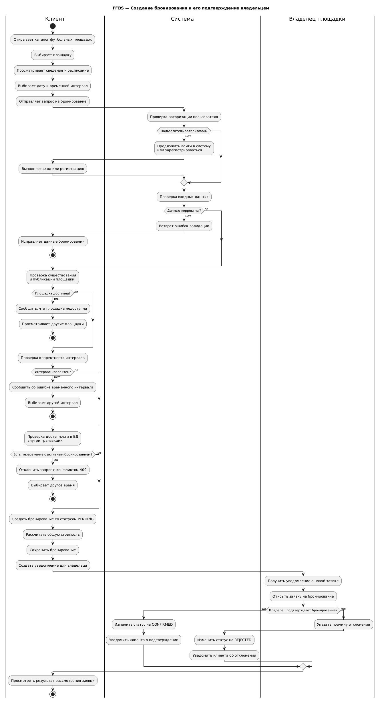
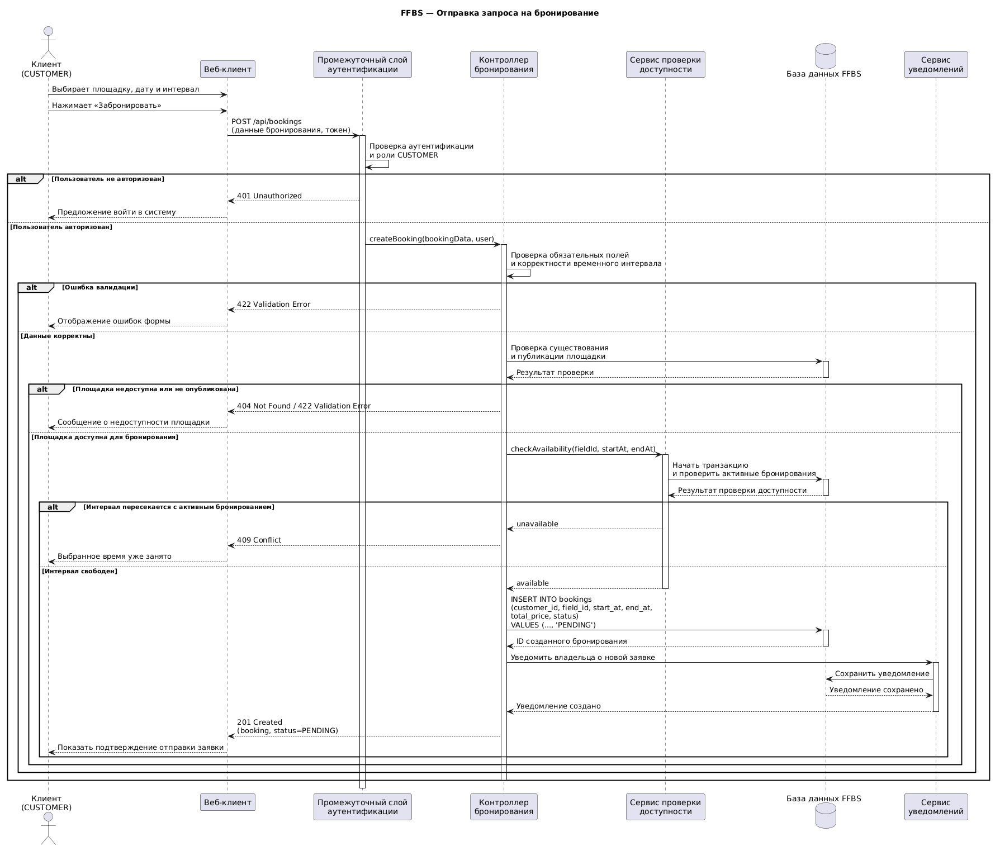
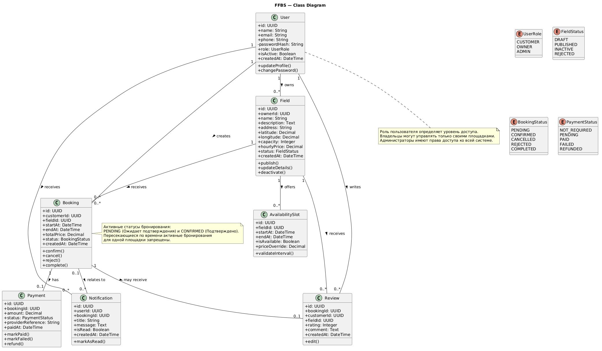
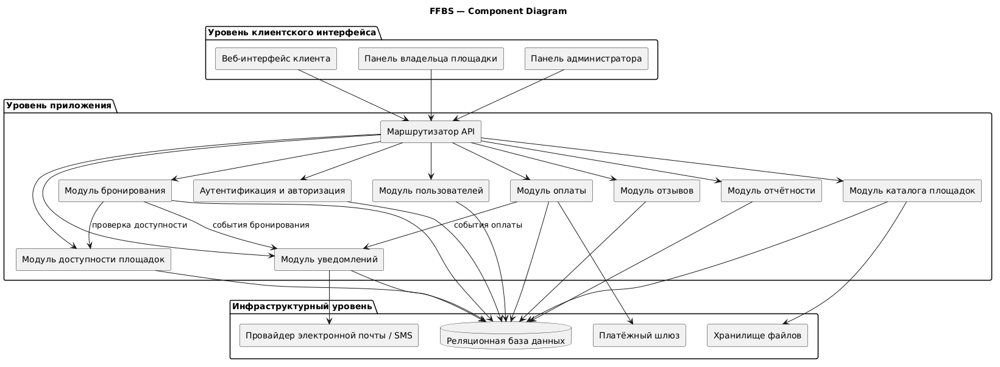
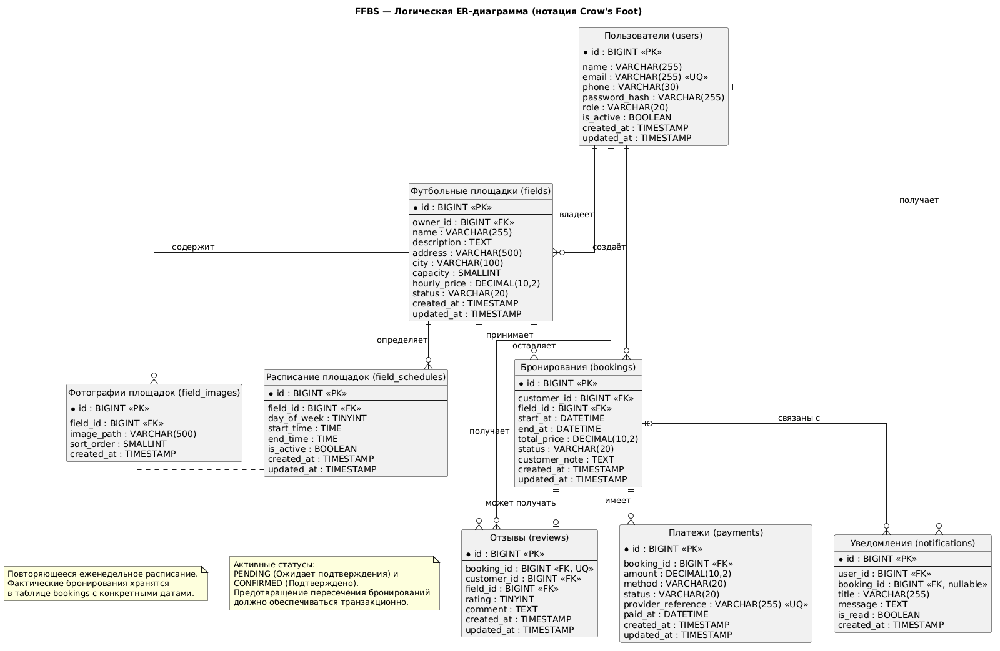
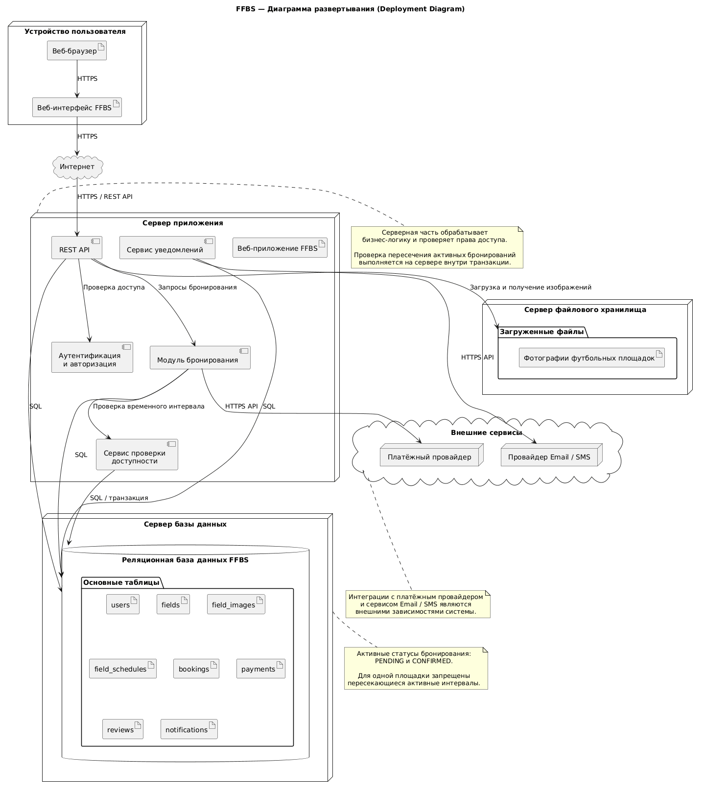

# ТЕХНИЧЕСКОЕ ЗАДАНИЕ
## на разработку информационной системы Football Field Booking System (FFBS)

**Краткое наименование:** FFBS  
**Версия:** 1.0  
**Дата:** 15.11.2026  
**Исполнитель:** [Фамилия, имя], группа [номер группы]  
**Заказчик:** владельцы футбольных площадок города и пользователи платформы (условно)  
**Срок выполнения:** текущий семестр согласно учебному плану

---

# 1. Общие сведения

## 1.1. Наименование системы
Полное наименование — **Football Field Booking System (FFBS)**, информационная система поиска и бронирования футбольных площадок.

## 1.2. Основание для разработки
Необходимость объединить сведения о футбольных площадках города на единой платформе и автоматизировать поиск, проверку доступности времени и отправку заявок на бронирование.

## 1.3. Заказчик и исполнитель
Условный заказчик — владельцы футбольных площадок и пользователи платформы. Исполнитель — студент/разработчик учебного проекта.

## 1.4. Термины и определения
- **Площадка** — спортивный объект, предлагаемый для игры в футбол.
- **Владелец (OWNER)** — пользователь, управляющий своими площадками.
- **Клиент (CUSTOMER)** — пользователь, который ищет площадку и бронирует время.
- **Администратор (ADMIN)** — пользователь с правами общего управления платформой.
- **Бронирование** — заявка на использование площадки в определённый временной интервал.
- **MVP** — минимальная работоспособная версия системы.
- **ФТ/НФТ** — функциональные и нефункциональные требования.

# 2. Назначение и цели создания системы

## 2.1. Назначение
FFBS — единая городская платформа. Владельцы разных площадок самостоятельно регистрируются, добавляют и управляют своими объектами. Клиенты ищут площадки, сравнивают информацию, выбирают подходящее время и отправляют заявку на бронирование.

## 2.2. Измеримые цели
1. Все зарегистрированные площадки отображаются в едином каталоге с адресом, ценой, вместимостью, фотографиями и расписанием.
2. Простой поиск в тестовой среде выдаёт результат не более чем за 3 секунды.
3. Для одной площадки не принимаются два активных бронирования с пересекающимися временными интервалами.
4. Владелец управляет только площадками, принадлежащими его учётной записи.
5. Права доступа ко всем защищённым операциям проверяются на стороне сервера.
6. Данные бронирования и история изменения его статуса хранятся в базе данных.

## 2.3. Границы проекта
**В MVP входят:** регистрация и вход; роли CUSTOMER/OWNER/ADMIN; профиль; добавление и управление площадками; фотографии; еженедельное расписание доступности; каталог и поиск; бронирование; проверка пересечения временных интервалов; управление бронированиями; административный контроль.

**За пределами MVP (Won't):** отдельное мобильное приложение; обязательная интеграция с банковским платёжным шлюзом; GPS в реальном времени; внешние CRM и бухгалтерские системы; сложная система скидок и абонементов. Таблицы платежей, отзывов и уведомлений предусмотрены моделью данных, однако подключение к реальным провайдерам относится к отдельному этапу.

# 3. Характеристика объекта автоматизации

## 3.1. Объект автоматизации
Процесс предоставления футбольных площадок, управления расписанием их использования и приёма заявок клиентов. Платформа предназначена для всего города, а не для одного владельца.

## 3.2. Участники системы

| Роль | Обязанности |
|---|---|
| CUSTOMER | Поиск, просмотр информации, выбор времени и отправка заявки на бронирование |
| OWNER | Управление собственными площадками, фотографиями, расписанием и связанными бронированиями |
| ADMIN | Управление пользователями, ролями и объявлениями о площадках на уровне платформы |

## 3.3. Основные процессы
**Регистрация:** пользователь отправляет данные; сервер проверяет обязательные поля и уникальность email; пароль сохраняется в виде хеша; после входа определяется роль пользователя.

**Добавление площадки:** владелец вводит сведения о площадке, адрес, город, вместимость и цену; добавляет фотографии и расписание; сервер проверяет право владения; площадка публикуется.

**Бронирование:** клиент выбирает площадку и временной интервал; сервер проверяет статус площадки, корректность интервала и отсутствие активного пересекающегося бронирования; если условия выполнены, бронирование сохраняется в транзакции, иначе запрос отклоняется.

## 3.4. Словарь предметной области

| Понятие | Значение |
|---|---|
| Расписание доступности | Повторяющиеся еженедельные интервалы работы площадки |
| Активное бронирование | Бронирование со статусом PENDING или CONFIRMED |
| Платёж | Финансовая операция, связанная с бронированием |
| Отзыв | Оценка и комментарий клиента после завершения бронирования |
| Уведомление | Внутреннее сообщение пользователю |

## 3.5. Отличия от аналогичных решений
Основное отличие — модель единой городской платформы: независимые владельцы работают в одной системе, но права каждого владельца ограничены его собственными данными. Клиент находит площадки разных владельцев через единый каталог.

# 4. Требования к системе

## 4.1. Требования к системе в целом

**Архитектура**
- Клиент-серверная архитектура.
- Backend на Go с HTTP/JSON API.
- Frontend на HTML, CSS и JavaScript.
- База данных MySQL; XAMPP может использоваться в локальной среде.
- Слои API, аутентификации, логики бронирования и доступа к данным должны быть разделены.

**Надёжность**
- Сохранение бронирования выполняется в транзакции.
- При ошибке незавершённая операция отменяется с помощью ROLLBACK.
- Резервная копия базы данных создаётся ежедневно.
- Восстановление из резервной копии периодически проверяется.

**Безопасность**
- Пароли хранятся только в виде хеша.
- Права доступа проверяются на сервере.
- OWNER может изменять только площадки, у которых owner_id соответствует его учётной записи.
- Входные данные проходят проверку.
- В производственной среде используется HTTPS.
- Пароли и секретные ключи не должны попадать в GitHub.

**Производительность**
- Простой поиск в тестовой среде выдаёт результат не более чем за 3 секунды.
- Параллельные запросы не должны приводить к двойному бронированию.
- Проверка пересечения интервалов выполняется на сервере и внутри транзакции.

**Сопровождаемость**
- Код имеет модульную структуру.
- Настройки окружения хранятся отдельно от исходного кода.
- Изменения базы данных управляются миграциями.
- Инструкция по запуску находится в README.

## 4.2. Функциональные требования

| Код | Функция | Описание | Приоритет |
|---|---|---|---|
| ФТ-01 | Регистрация | Создание учётной записи и проверка уникальности email | Must |
| ФТ-02 | Вход/выход | Начало и завершение пользовательской сессии | Must |
| ФТ-03 | Профиль | Просмотр и редактирование разрешённых личных данных | Should |
| ФТ-04 | Роли | Назначение и управление ролями CUSTOMER/OWNER/ADMIN | Must |
| ФТ-05 | Добавление площадки | Владелец регистрирует новую площадку | Must |
| ФТ-06 | Управление площадкой | Редактирование, публикация и отключение своей площадки | Must |
| ФТ-07 | Фотографии | Добавление и сортировка фотографий | Should |
| ФТ-08 | Расписание | Управление еженедельными временными интервалами | Must |
| ФТ-09 | Каталог/поиск | Поиск по городу, цене и характеристикам | Must |
| ФТ-10 | Информация о площадке | Отображение адреса, цены, вместимости, фотографий и расписания | Must |
| ФТ-11 | Проверка доступности | Проверка времени и пересекающихся бронирований | Must |
| ФТ-12 | Создание бронирования | Отправка заявки клиентом | Must |
| ФТ-13 | Управление бронированиями | Просмотр относящихся к пользователю бронирований и изменение статуса | Must |
| ФТ-14 | Администрирование | Контроль пользователей и площадок | Should |
| ФТ-15 | Платежи | Хранение записей о платежах; провайдер вне MVP | Could |
| ФТ-16 | Отзывы | Оценка и комментарий после завершённого бронирования | Could |
| ФТ-17 | Уведомления | Хранение и отображение уведомлений | Should |

### Пользовательские истории (User Stories)
1. **US-01 (Must):** Как новый пользователь, я хочу создать учётную запись, чтобы пользоваться системой. Критерий приёмки: повторный email отклоняется; пароль хешируется.
2. **US-02 (Must):** Как владелец, я хочу добавить свою площадку, чтобы она появилась в каталоге. Критерий приёмки: площадка связывается с owner_id владельца.
3. **US-03 (Must):** Как владелец, я хочу задавать расписание работы. Критерий приёмки: время окончания позже времени начала.
4. **US-04 (Must):** Как клиент, я хочу искать площадки по городу и цене. Критерий приёмки: отображаются только опубликованные объявления.
5. **US-05 (Must):** Как клиент, я хочу забронировать свободное время. Критерий приёмки: заявка с пересекающимся активным интервалом отклоняется.
6. **US-06 (Must):** Как владелец, я хочу редактировать только свои площадки. Критерий приёмки: изменение площадки другого владельца отклоняется.
7. **US-07 (Should):** Как администратор, я хочу контролировать пользователей и объявления. Критерий приёмки: операция разрешена только роли ADMIN.
8. **US-08 (Should):** Как клиент, я хочу просматривать историю своих бронирований. Критерий приёмки: отображаются только бронирования данного пользователя.

### Матрица доступа «роль × функция»

| Функция | ADMIN | OWNER | CUSTOMER |
|---|---|---|---|
| Просмотр каталога и площадок | да | да | да |
| Управление личным профилем | да | да | да |
| Добавление площадки | контроль | да | — |
| Редактирование/отключение площадки | все площадки | только свои | — |
| Управление фотографиями и расписанием | контроль | только свои | — |
| Создание бронирования | контроль | контроль | да |
| Просмотр бронирований | все | по своим площадкам | только свои |
| Управление пользователями и ролями | да | — | — |
| Создание отзыва | контроль | — | после завершённого бронирования |
| Просмотр личных уведомлений | да | да | да |

Все права проверяются в API и на серверном уровне; скрытие кнопок в интерфейсе не является достаточной защитой.

## 4.3. Требования к видам обеспечения
- **Информационное:** база данных FFBS с восемью основными таблицами: `users`, `fields`, `field_images`, `field_schedules`, `bookings`, `payments`, `reviews`, `notifications`; InnoDB; UTF-8 (`utf8mb4`); PK/FK, UNIQUE, CHECK и индексы.
- **Программное:** Go, HTML5, CSS3, JavaScript, MySQL, Git/GitHub, PlantUML; API — HTTP/JSON и HTTPS в производственной среде.
- **Техническое:** компьютер разработчика с Go, VS Code, Git и MySQL/XAMPP; для размещения — сервер с достаточными CPU/RAM/SSD. Точная конфигурация определяется при развёртывании.
- **Лингвистическое:** интерфейс и инструкции на таджикском языке; хранение и поиск кириллического текста без искажений.
- **Организационное:** инструкции для трёх ролей; изменения фиксируются в Git, стабильные версии отмечаются тегами.

# 5. Модели системы

Диаграммы PNG должны находиться по указанным ниже путям. Если фактические имена файлов отличаются, замените ссылки на имена, используемые в репозитории.

## 5.1. Диаграмма вариантов использования

**Рисунок 1.** Три роли — CUSTOMER, OWNER и ADMIN — связаны с функциями платформы. Клиент выполняет поиск и бронирование; владелец управляет своими площадками; администратор контролирует платформу и пользователей.

## 5.2. Процесс бронирования — Activity

**Рисунок 2.** Процесс начинается с выбора площадки и времени и завершается проверкой доступности. Пересекающийся временной интервал отклоняется.

## 5.3. Последовательность бронирования — Sequence

**Рисунок 3.** Показано взаимодействие клиента, интерфейса, API, Booking Service и MySQL. Сохранение выполняется в транзакции; при неудаче используется ROLLBACK.

## 5.4. Диаграмма классов

**Рисунок 4.** Показаны классы User, Field, FieldImage, FieldSchedule, Booking, Payment, Review и Notification, а также связи между ними.

## 5.5. Диаграмма компонентов

**Рисунок 5.** Интерфейс, REST API, аутентификация, модуль бронирования, проверка доступности и слой данных представлены как отдельные компоненты.

## 5.6. ER-диаграмма

**Рисунок 6.** Отражены восемь основных таблиц и связи 1:N и 1:0..1. Внешние ключи связывают пользователей, площадки, бронирования, платежи, отзывы и уведомления.

## 5.7. Диаграмма развёртывания

**Рисунок 7.** Показаны устройство пользователя, браузер, сервер приложения, REST API, сервер БД, файловое хранилище и внешние зависимости. Пользователь взаимодействует с системой через HTTPS, приложение — с БД через SQL.

### Прослеживаемость User Story до таблиц базы данных

| История | Модель/процесс | Таблицы БД |
|---|---|---|
| US-01 Регистрация | Use Case/Sequence Register | `users` |
| US-02 Добавление площадки | Use Case/Activity Add Field | `users`, `fields` |
| US-03 Расписание | Use Case Manage Schedule | `fields`, `field_schedules` |
| US-04 Поиск | Use Case Search Fields | `fields`, `field_images`, `field_schedules` |
| US-05 Бронирование | Activity/Sequence Booking | `users`, `fields`, `bookings` |
| US-06 Защита прав владельца | Authorization flow | `users`, `fields` |
| US-07 Администратор | Use Case Admin | `users`, `fields` |
| US-08 История | Use Case View Bookings | `bookings`, `fields`, `payments` |

# 6. Состав и содержание работ

| Этап | Работы | Результат | Срок |
|---|---|---|---|
| 1. Проектирование | Анализ, ТЗ, модели и БД | Документы и schema | День 8 (Р-1) |
| 2. Дизайн | UX/UI и прототип | Макет и прототип | День 9 |
| 3. Frontend | HTML/CSS/JS | Страницы интерфейса | Дни 10–11 |
| 4. Backend | Go API, auth, БД и бронирование | Работающий MVP | Дни 12–14 |
| 5. Тестирование | Тест-кейсы и исправление ошибок | Отчёт о тестировании | День 15 |
| 6. Публикация | Сервер, HTTPS и backup | Развёрнутая версия | День 16 (Р-2) |

Календарные даты необходимо согласовать с расписанием занятий группы.

# 7. Порядок контроля и приёмки

## 7.1. Проверки
1. Функциональное тестирование всех требований Must с учётными записями ADMIN, OWNER и CUSTOMER.
2. Проверка прав: OWNER не может редактировать площадку другого владельца.
3. Проверка бронирования: корректный интервал принимается, пересекающийся — отклоняется.
4. Проверка транзакций: при ошибке неполные данные не должны сохраняться.
5. Проверка БД: schema/migrations и seed выполняются без ошибок; FK/UNIQUE/CHECK работают.
6. Проверка производительности: простой поиск в тестовой среде выполняется не более чем за 3 секунды.
7. Проверка безопасности: пароли не хранятся в открытом виде, защищённый endpoint недоступен без разрешения.

## 7.2. Примеры тест-кейсов

| ID | Проверяемое действие | Ожидаемый результат |
|---|---|---|
| TC-01 | Регистрация с новым email | Учётная запись создаётся |
| TC-02 | Повторный email | Запрос отклоняется |
| TC-03 | Неверный пароль | Вход отклоняется |
| TC-04 | OWNER добавляет площадку | Площадка сохраняется с корректным owner_id |
| TC-05 | OWNER редактирует чужую площадку | Доступ запрещён |
| TC-06 | CUSTOMER бронирует свободное время | Бронирование сохраняется |
| TC-07 | CUSTOMER выбирает пересекающееся время | Запрос отклоняется |
| TC-08 | Два одновременных запроса на один интервал | Принимается только одно пересекающееся бронирование |
| TC-09 | Поиск с фильтром по городу | Отображаются только подходящие результаты |
| TC-10 | Просмотр бронирования другого пользователя | Доступ запрещён |
| TC-11 | Выполнение schema и seed | SQL выполняется без ошибок |
| TC-12 | Восстановление резервной копии | Данные восстанавливаются |

## 7.3. Критерии приёмки
Система считается принятой, если выполнены 100% требований Must; проверки прав доступа пройдены; пересекающиеся бронирования предотвращаются; migration/schema и seed выполняются без ошибок; критические ошибки отсутствуют; предоставлены README и инструкция по развёртыванию.

# 8. Требования к документированию

1. `README.md` — описание, требования к среде и инструкция по запуску.
2. `docs/01-domain-analysis.md` — анализ предметной области.
3. `docs/02-comparison-matrix.md` — сравнение аналогичных решений.
4. `docs/03-short-spec.md` — краткое ТЗ и пользовательские истории.
5. `docs/04-behavior/` — Use Case, Activity, Sequence и исходники PlantUML.
6. `docs/05-structure/` — Class и Component.
7. `docs/06-logical-model.md` — логическая модель БД.
8. `docs/06-er-diagram.png` — ER-диаграмма.
9. `database/schema.sql` или миграции — физическая структура БД.
10. `database/seed.sql` — тестовые данные.
11. `database/queries.sql` — SQL-запросы.
12. `docs/07-deployment.puml` и `docs/07-deployment.png` — диаграмма развёртывания.
13. `docs/08-technical-specification.md` — настоящий документ.
14. `docs/15-test-cases.md` — тест-кейсы и результаты.
15. `docs/16-deploy.md` — инструкция по развёртыванию.
16. Краткое руководство пользователя для CUSTOMER, OWNER и ADMIN.

Техническое задание должно быть самодостаточным; ссылки на другие файлы не должны заменять описание требований.

# 9. Источники разработки

1. ГОСТ 34.602 — состав и содержание технического задания на автоматизированную систему.
2. Документы анализа предметной области и требования проекта FFBS.
3. Логическая модель базы данных FFBS.
4. Диаграмма развёртывания FFBS (`07-deployment.puml`).
5. Официальная документация Go: https://go.dev/doc/
6. Официальная документация MySQL: https://dev.mysql.com/doc/
7. Документация Git: https://git-scm.com/doc
8. Документация PlantUML: https://plantuml.com/

---

## Приложение А. Важные проектные решения

- FFBS является единой городской платформой.
- OWNER управляет только площадками, привязанными к его учётной записи.
- Активные статусы бронирования — `PENDING` и `CONFIRMED`; их временные интервалы для одной площадки не должны пересекаться.
- `field_schedules` хранит повторяющееся еженедельное расписание; дата и время конкретного бронирования сохраняются в `bookings`.
- Статус платежа хранится отдельно от статуса бронирования.
- Платёжный провайдер и Email/SMS являются внешними зависимостями; до интеграции необходимо выбрать провайдера и изучить условия его API.
- Имена PNG в разделе 5 необходимо сверить с фактическими именами файлов в репозитории.

## Приложение Б. План защиты Р-1 (5–7 минут)

- **2 минуты:** тема, проблема заказчика, три роли и модель городской платформы.
- **2 минуты:** прослеживаемость US-05: Use Case → Activity/Sequence → таблицы `users`, `fields`, `bookings`.
- **1 минута:** выполнение schema/migration, seed и одного SQL-запроса.
- **1–2 минуты:** ответы на теоретические вопросы и объяснение проектных решений.

### Возможные вопросы преподавателя

**1. Чем полное ТЗ отличается от краткого ТЗ?**  
Краткое ТЗ в основном определяет границы и функции системы. Полное ТЗ также включает нефункциональные требования, виды обеспечения, модели, этапы, тестирование и критерии приёмки.

**2. Для чего нужна матрица доступа?**  
Она определяет права каждой роли относительно функций системы. В коде эти права реализуются через middleware и проверку роли/владения объектом на сервере.

**3. Как предотвращается двойное бронирование?**  
Сервер проверяет активные бронирования со статусами `PENDING` и `CONFIRMED`. Проверка и INSERT выполняются в транзакции, пересекающиеся интервалы отклоняются.

**4. Почему `field_images` является отдельной таблицей?**  
У одной площадки может быть несколько фотографий. Отдельная таблица хранит связь 1:N и позволяет не сохранять список фотографий в одном столбце.

**5. Почему данные владельца хранятся в `users`?**  
Один владелец может иметь несколько площадок. `fields.owner_id` ссылается на `users.id` и предотвращает дублирование данных владельца.

**6. Почему важен раздел Won't?**  
Он определяет функции, которые не входят в текущую версию, помогает управлять ожиданиями заказчика и предотвращает необоснованное увеличение объёма работ.
