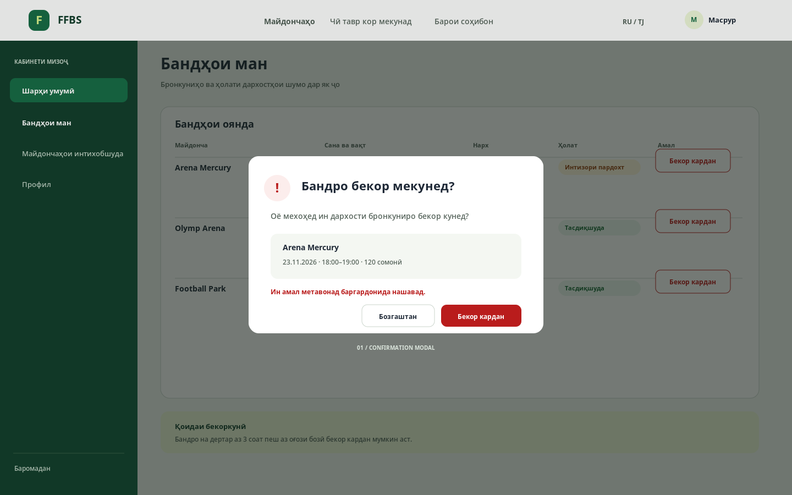
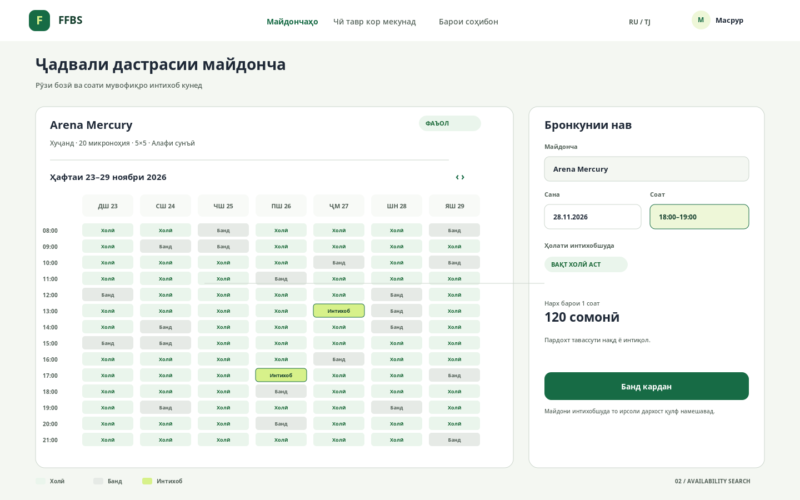
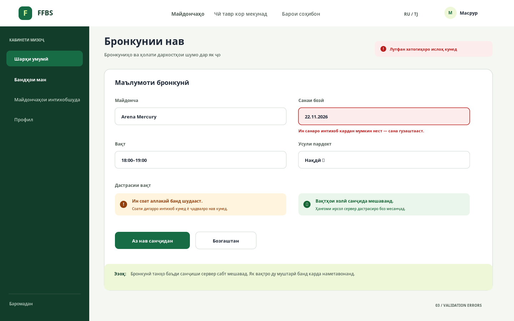
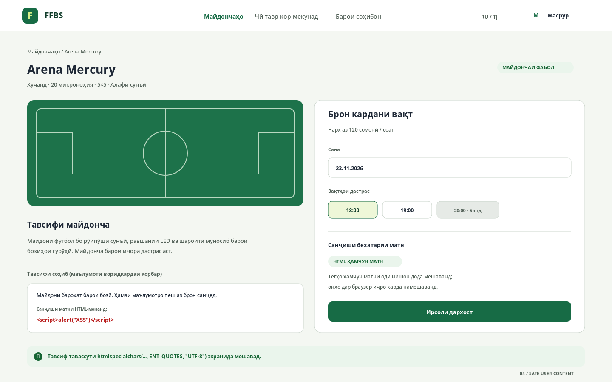

# FFBS — дополнительные экраны и состояния (`docs/11-screens`)

Анализ образца: НЕИЗВЕСТНО.

В образце четыре типа состояний: модальное подтверждение удаления, экран поиска/сетевой проверки, ошибки валидации и безопасное отображение пользовательского текста. Для FFBS они перенесены на процессы бронирования футбольных площадок.

> **Статус:** SVG — редактируемые векторные макеты состояний интерфейса, PNG — растровые превью для просмотра в GitHub. Это проектные представления, а не доказательство прохождения тестов или наличия всех состояний в текущей версии сайта.

## Макеты

### 01. Подтверждение отмены бронирования

[Открыть SVG-исходник](01-booking-cancel-modal.svg)

### 02. Поиск свободного времени и недельная сетка

[Открыть SVG-исходник](02-availability-search.svg)

### 03. Ошибки валидации бронирования

[Открыть SVG-исходник](03-booking-validation-errors.svg)

### 04. Безопасное отображение пользовательского текста

[Открыть SVG-исходник](04-xss-safe-user-content.svg)

## Анализ и адаптация

1. **Delete modal → отмена брони.** В EDMS подтверждается удаление документа. В FFBS опасное действие — отмена активной заявки. Макет показывает название поля, дату, время и сумму. В текущем `my.php` используется нативный JavaScript `confirm()`; кастомное диалоговое окно ещё нужно реализовать. Серверный обработчик `cancel.php` ограничивает отмену за 3 часа до игры.
2. **Network/search → доступность расписания.** В исходном образце `network-search.png` показана панель DevTools Network с пустым списком запросов. Это слабое доказательство работающего поиска. Для FFBS вместо неё создан прикладной экран: недельная сетка, свободные/занятые часы и форма выбора времени. `field.php` формирует расписание; `book.php` повторно проверяет слот на сервере в транзакции.
3. **Validation errors → ошибки формы бронирования.** В исходном `validation-errors.png` отображается `404 Not Found`, а не сама форма с ошибками. В FFBS макет показывает два сценария: прошедшую дату и уже занятый временной интервал. `book.php` проверяет формат даты, прошедшее время, диапазон до 70 дней, рабочие часы и конфликт слота.
4. **XSS-safe text → безопасный вывод описания площадки.** Владелец может ввести HTML-подобный текст в описание. `config.php` содержит helper `e($s)`, который применяет `htmlspecialchars((string)$s, ENT_QUOTES, 'UTF-8')`; `field.php` выводит описание через `e($f['description'])`. Макет иллюстрирует ожидаемое отображение текста как обычной строки.

## Связь с файлами проекта

| Экран | Файлы | Что проверять |
|---|---|---|
| 01 | `my.php`, `cancel.php`, `config.php` | Права владельца заявки, ограничение 3 часа, CSRF, подтверждение действия |
| 02 | `field.php`, `book.php`, `database.sql` | Свободные часы, статус отменённых броней, повторная проверка слота |
| 03 | `book.php`, `field.php` | Ошибки даты/времени, понятные сообщения, отсутствие записи при конфликте |
| 04 | `config.php`, `field.php`, `index.php` | Экранирование пользовательских значений; не использовать небезопасный `innerHTML` |

## Тестовые сценарии

| ID | Действие | Ожидаемый результат |
|---|---|---|
| FFBS-11-01 | Клиент подтверждает отмену брони | Отменяется только его активная бронь; при недопустимом сроке сервер отклоняет действие |
| FFBS-11-02 | Клиент выбирает прошедшую дату/час | Бронь не создаётся; отображается понятная ошибка |
| FFBS-11-03 | Два клиента одновременно выбирают один слот | Создаётся не более одной активной брони; второй запрос получает конфликт |
| FFBS-11-04 | В описание вводится `` | Строка отображается как текст; JavaScript не выполняется |
| FFBS-11-05 | В название/описание вводятся кавычки и HTML-атрибуты | Значения экранируются и не меняют структуру страницы |

**Примечание:** это план проверки и ожидаемые результаты, а не отчёт о фактически выполненном тестировании.

SVG можно импортировать в Figma как редактируемые векторные слои.
